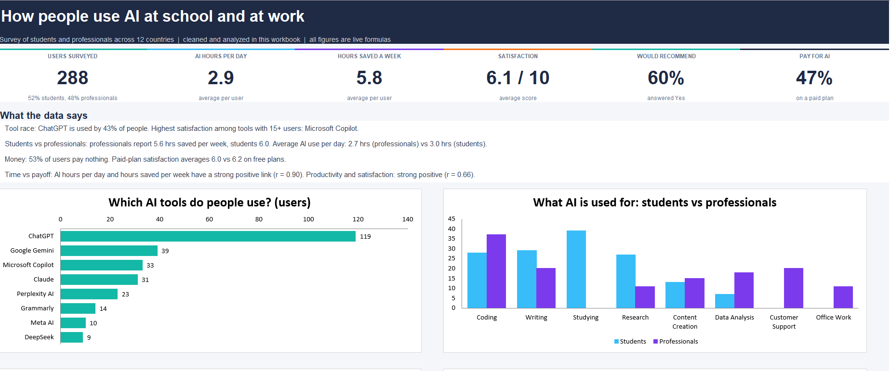
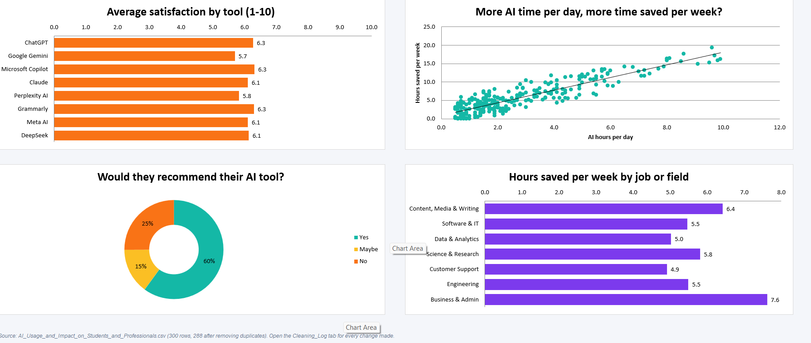

# AI Usage and Impact on Students and Professionals

Data cleaning and Excel dashboard analyzing how students and professionals use AI tools, how much time they report saving, and how satisfied they are.

## Project Overview

This project takes a messy survey dataset on AI use and turns it into a clean, documented workbook with a one-page dashboard. The goal was to answer a simple question: how do students and professionals actually use AI, and does it pay off?

| | |
|---|---|
| Dataset | 300 survey records, 19 columns, respondents from 12 countries |
| Final dataset | 288 records after removing duplicates |
| Tool | Microsoft Excel |
| Deliverable | A five-sheet workbook with a formula-driven dashboard |

## Data Cleaning

The raw file contained duplicate rows, inconsistent spellings, numbers stored as text, impossible values, and free-text job titles in several languages. Key steps:

- Removed 12 exact duplicate records
- Blanked three impossible values (an age of 97, 23 hours of AI use per day, and a monthly student income of 250,000) instead of guessing replacements
- Grouped 126 job and major titles into 7 fields so they could be analyzed
- Kept odd but possible records and tagged them in a Data_Flags column

Additional preparation included:
- Converting inconsistently formatted numeric values
- Standardizing country names, gender labels, and AI tool names
- Addressing missing values during analysis
- Creating additional analytical fields
- Maintaining a cleaning log for transparency

## Key Findings

| Metric | Result |
|---|---|
| Records analyzed | 288 |
| Average AI usage | 2.87 hours/day |
| Average reported time saved | 5.81 hours/week |
| ChatGPT share of valid tool responses | 42.8% |
| Correlation: AI usage vs. time saved | 0.90 |
| Correlation: productivity vs. satisfaction | 0.66 |

### Adoption and Satisfaction

ChatGPT was the most commonly reported AI tool in the dataset. Among platforms with at least 15 users, Microsoft Copilot recorded the highest average satisfaction score.

### Students vs. Professionals

Students reported approximately 6.0 hours saved per week, compared with 5.6 hours among professionals.

### Usage and Productivity

A strong positive correlation was observed between daily AI usage and reported weekly time savings. This indicates an association within the dataset, not proof that additional usage causes productivity gains.

## Excel Dashboard

A formula-driven Excel dashboard analyzing AI adoption, usage patterns, productivity, and user satisfaction.

### Dashboard Overview

### Dashboard Charts

**[View Full Excel Analysis](AI_Usage_Analysis.xlsx)**

## Workbook Structure

| Worksheet | Purpose |
|---|---|
| Dashboard | Visualizations and key performance indicators |
| Analysis | Formula-driven analytical tables |
| Clean_Data | Prepared dataset |
| Cleaning_Log | Documented cleaning decisions |
| Raw_Data | Original source data |

## Skills Demonstrated

- Data cleaning and standardization
- Excel formulas (COUNTIFS, AVERAGEIFS, CORREL, INDEX/MATCH, IFERROR)
- Segmentation and correlation analysis
- Dashboard design and data visualization
- Documentation of assumptions and data quality decisions

## Business Relevance

The analysis illustrates how organizations can use survey-style data to evaluate technology adoption, compare user experiences, and identify potential opportunities for AI training and productivity improvement.

Findings describe the analyzed sample and should not be generalized to all AI users without additional validation.

---

**Lazourde Alshafie**
Business Intelligence Technology | University of North Florida
